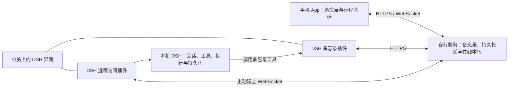

# 技术方案草案

状态：已实现后端、Android HTTP 客户端和两个独立 DSH 插件；隔离环境已验证原生接单及文本会话转发，本地安装和公网验证范围见 STATUS.md。旧工程已归档，以下不受旧目录、协议和数据库结构约束；实现及验证范围以 STATUS.md 为准。

## 当前后端实现

用户指定 Python、FastAPI 和 uv，服务位于 `server/`，Python 基线为 3.13。使用标准库 sqlite3，不引入 ORM、独立 MQ 或 Redis。数据库操作与密码计算在线程池执行，设备通知在应用事件循环内运行；部署限定单服务进程。

本轮实现账户创建、设备登录/刷新/撤销、带项目名称的备忘录版本化 CRUD/追加，以及 SQLite 持久投递。仅保留账户、设备、备忘录、投递四张表。对外 API/MCP 仅提供基本业务功能，备忘录内包含投递状态；设备 WebSocket 负责直接推送指令和接收回执。新增一个认证 `/api/remote/call` 入口，经原设备 WebSocket 转发固定会话操作；DSH 执行端由 `plugins/devices` 承载。操作协议和运行方法见 [后端说明](server/README.md)，不将方案中其余能力视为已实现。

实现选择：项目仅为备忘录的 `project` 文本字段，空字符串表示未归类；创建时附带的指令复制项目名称和正文，默认新建会话。创建重试返回现有记录的当前状态；修改、追加、删除以版本号保护，旧版本重试返回 409，由客户端核对结果，不能盲目换版本再提交。删除与取消尚未发送的指令在同一事务完成，进入发送未确认时拒绝删除。MCP 按锁定 SDK 的实际支持使用 2025-11-25 协议，不能仅凭查阅更新规范就宣称已兼容。

## 组成和数据流

`plugins/memos` 和 `plugins/devices` 是独立分发包，共享登录、续期及本地持久记录。上游只提取 carrier/控制路由并保留许可证和对应测试，未引入其账户服务、全局网关切换或终端能力。当前使用 HTTPS/WSS，未实现端到端加密。插件的 Node 后台在 macOS 读取系统 HTTPS 代理及常见例外，HTTP 与 WebSocket 共用代理选择；也支持进程 `HTTPS_PROXY` / `NO_PROXY`。

两套插件分别按业务划分，不按 Host / Client 划分。两者都可包含 Host 后台模块和 Client 界面模块，共用小型协议与连接库；共享库不增加部署服务。

## DSH 备忘录插件

- Client 通过 DSH 正式侧栏/主面板插槽提供全宽备忘录方格与编辑抽屉、基础 Markdown 阅读预览、同步反馈及冲突对比。搜索/新建集中首行，项目筛选与已加载结果排序在第二行；分类沿用 `project`，不实现置顶。设置仍使用抽屉，不改 DSH DOM。
- Host 提供读取以及受控创建、追加、更新工具，使用与人工编辑相同的数据服务。
- 服务端保存备忘录；本地保留编辑草稿和待确认写入，不提供完整离线缓存/同步。使用服务端 memo ID，不以本地路径作为跨端身份。
- 建议首版正文采用纯文本 / Markdown，标题、版本、更新时间等作为结构化字段。是否支持附件待定。
- 创建携带稳定请求 ID；修改、追加和删除携带基准版本。版本冲突时保留原写入、允许读取服务器内容进行人工核对；独立冲突副本及自动合并尚未实现。重试是否已成功需要结合最新记录核对，AI 与人工编辑服从同样规则。
- 工具返回应区分“本地已保存”“服务器已确认”“存在冲突”。不因写入成功就宣称其他离线设备已同步。

旧 sync-client 可作为协议和冲突保护的参考，但不将其 Node 文件系统实现作为手机端的前提，也不恢复旧后台自动合并流程。

## DSH 远程访问插件

- Host 主动连接中转服务并报告设备在线状态，不依赖手机直接访问电脑地址。
- 已将列表、最近记录快照、创建、续聊、停止，以及工作区列表、模型目录和模型选择转接至 DSH 正式接口。远端创建可指定已有 `workspaceId`，由 DSH 绑定项目和执行目录；这是远端原生工作区，不新增服务器项目表，也不将备忘录项目文本自动映射为目录。审批/提问仍需回到执行电脑；不承诺完整自定义插件界面。
- B 在原生创建前持久保存稳定 sessionId/requestId 与目录，调用 DSH 幂等创建及 prompt，确认后才记录接收并 ACK；重投返回原会话。未新增 Agent 状态机。
- Client 提供设备选择和远程会话面板，使电脑 A 也能操作电脑 B。只有手机 App 不足以覆盖电脑之间访问的需求。
- 一个设备可以同时是访问方和执行方，具体会话的所属设备始终明确。

在线中转只保留内存等待项：每设备最多 16 个、全局最多 128 个，12 秒超时。未知接收结果必须用原 requestId 重试，不进入离线任务队列。最近 30 条消息的记录按需读取，服务端不保存会话副本。

远程界面不自动获得所有第三方 DSH 插件的界面能力。首轮需核对正文、工具事件、审批和提问的表达；完整自定义插件界面兼容不作为默认承诺。

## 自有服务

采用一个服务进程，按模块划分备忘录、投递和中转职责，SQLite 存于服务所在机器。用户已确认指令需要离线排队；首版以 SQLite 投递表作为持久队列，不预设独立消息队列、Redis 或服务器 Agent。投递和首批文本会话转发已实现；审批/提问及完整 DSH 界面中转仍后置。

| 职责 | 服务端保存或维护什么 |
| --- | --- |
| 个人身份与设备 | 认证、设备登记和撤销、连接状态 |
| 备忘录 | 已同步内容、项目名称、版本、创建请求标识及删除标记 |
| 指令投递 | 指令和内容快照、目标设备、去重标识、投递状态及 B 返回的会话关联 |
| 远程会话中转 | 在线连接和请求路由，转发命令、回执与会话事件 |

完整会话历史与执行状态归原设备 DSH。服务端转发成功不等于 B 已接收；不保存完整会话副本。带指令的备忘录可以等待离线 B 上线，但会话查看和即时续聊不因此变成离线可用。服务仍有存储、连接和流量成本，不称为零负担。

### 内容、操作与项目

用户确认保留四张表；取消独立项目、登录记录和通用请求去重表。准确字段以 `server/src/dogo_server/db.py` 为准，职责如下：

- `accounts`：账户身份和密码哈希。与设备分开，表达一个账户拥有多台设备。
- `devices`：设备归属、名称、类型、是否启用，以及当前刷新凭据哈希、到期时间和令牌版本。每设备只保留一份有效登录状态，没有登录历史表。
- `memos`：正文、项目分组名称、分类、标签、创建设备、版本及删除标记。项目暂时没有独立内容，所以直接保存文本；分类和标签也不拆关系表。
- `dispatches`：一次明确的指令、目标设备、派发时正文/项目名称、投递状态和接收后的原生会话 ID。此表同时承担持久队列，默认新建会话。
- 创建备忘录和派发的 `request_id`、输入哈希直接落到各自业务表；账户内唯一约束和事务防止重复入库。重试返回已有记录当前状态，不重放历史响应。更新、追加和删除只按版本判断，不积累逐次操作记录。
- 设备名称是展示字段；由稳定 device_id 路由，必要时留名称快照。account_id 来自已验证身份，不能信任普通请求参数或模型传入值。
- 备忘录可反复修改，一次投递使用创建时的内容及指令快照。修改标签或正文不隐式重复派发；当前不提供已有备忘录再次执行的独立动作。
- “是否激活”不能同时表示备忘录可见、允许投递和执行成功。待投递取消、已接收之后停止，以及删除备忘录的关联行为需分别定义。
- 备忘录按记录版本同步，不同步服务器 SQLite 文件，也不要求套用文件目录同步层。离线删除需要删除标记，避免其他设备将旧内容重新上传。

用户界面只需一条内容及一个“保存并交给 B”动作；业务层在同一事务中保存备忘录与投递记录。创建和查询均返回同一备忘录结构，其中包含投递状态，不另外开放投递创建/查询/取消接口。没有指令时仅保存内容；不因普通编辑而发起执行。

项目当前只表达分组，例如个人账本或某个想法，不强制等于 Git 仓库、设备本地目录或一个长期会话。暂不提供统一改名或项目说明；以后出现独立项目内容再考虑拆表。如需指定工作目录，由执行端另定本地映射，不把另一台设备的路径直接照搬。

记账等持续业务的连续性应保存在项目下的业务记录中，而非依赖一个永不结束的会话。首版可以继续用备忘录采集原话并保存处理结果；准确统计需要何种结构化账目仍待业务方案明确，不自动增加专用账本系统。每笔记录的采集不必启动 Agent，有明确操作时才派发。周期归集/汇总与定时自动触发分开，后者尚未确认。

### 不独立部署 MQ 的投递方式

1. 通过同一 SQLite 事务保存备忘录和待投递指令；客户端重复提交使用同一幂等键。
2. SQLite 事务提交成功后，业务代码直接调用同进程 `wakeDevice(deviceId)`，通知对应在线设备有待处理记录；不需要 SQLite 主动推送，也不需要独立事件总线或轮询服务。设备连接完成时立即查询它的待投递记录，服务重启后通过设备重连恢复。
3. DSH 插件主动建立认证 WebSocket；服务端直接推送指令和内容快照，设备在同一连接回传接收确认，不另调用 HTTP 领取或确认接口。离线时记录留在 SQLite。
4. 每设备一个连接，一次等待一条接收回执；收到回执后立即推送下一条，不等待 Agent 执行完成。投递带稳定指令 ID，重连立即恢复未确认指令，超时后更换租约凭据重投；设备必须持久去重并复用原生会话映射。
5. B 确认接收需以本地持久记录为依据。投递成功与 DSH 执行成功分开，服务器首版只记录必要接收回执与会话引用，不复制完整执行历史。
6. 设备崩溃造成 DSH 已执行但回执无法确认时，核对实际会话或标记待核对，不盲目自动重跑。删除备忘录只取消未进入发送的指令；已发送未确认时返回冲突，即使租约过期也不假定撤回成功。已确认后删除不停止运行。

WebSocket 是已实现的设备投递通道，SQLite 记录是待办依据；断开网络不丢失记录。首批文本会话调用复用此通道；复杂交互中转后置，不承诺“恰好一次”执行。

### 唤醒与通信方式的取舍

- 推荐“提交后即时唤醒 + 设备上线补查 + 低频定时补漏”。定时器在现有服务进程内运行；例如 30–60 秒仅作为初始候选，实际频率按延迟目标和测量调整。查询按目标设备、投递状态等建索引并限制批次，不周期全表扫描正文。
- 唤醒提示仅在服务进程内部合并，不负责持久保存工作。连接处理器从 SQLite 选出未确认指令，直接通过 WebSocket 发送；设备收到后回执。丢唤醒由补查恢复，重复投递不应重复执行。
- 若只做低频异步指令，设备定时 HTTP 拉取就可成立，代码最直观，代价是等待间隔和空请求。长轮询可缩短等待，但仍需管理挂起连接、超时和重连。
- 当前同时需要实时远程会话，因此推荐每个在线 DSH 执行端复用一条 WebSocket，承载指令提示和按需订阅的会话事件；它是现有服务内的连接，不增加独立部署进程。手机只在使用实时功能时维持连接，不要求为等待 B 完成任务而一直后台联网。
- WebSocket 本身不保证可靠投递，也不意味着没有开销；还需心跳、重连退避和有界发送缓冲。目标服务器上的连接、CPU、内存和流量尚未实测。暂不为少量个人设备引入独立 MQ；多实例、高吞吐或复杂消费者需求出现后再评估。

通信依据：[RFC 6455](https://www.rfc-editor.org/rfc/rfc6455.html) 定义 WebSocket 的单连接双向通信与帧；[RFC 6202](https://www.rfc-editor.org/rfc/rfc6202.html) 说明 HTTP 轮询、长轮询和流式传输的取舍。协议事实不构成本项目的性能测试结果。

### API、MCP 与认证

- 常规 API 与 MCP 是同一应用服务的两种适配入口，共用身份解析、校验、业务规则和数据访问；不复制两套 CRUD 实现。
- MCP 提供备忘录读取、写入和设备列表，指令作为创建备忘录的可选字段；不提供独立派发管理工具。设备控制使用认证 WebSocket 推送与回执，持久队列仍由 SQLite 支撑。
- JWT 可作为访问凭证格式，但不替代登录、续期和撤销。自有客户端与插件可以携 Bearer 凭证调用；若支持通用 MCP 客户端标准登录，还需要相应 OAuth 授权与发现流程。按实际 DSH 支持的 MCP 版本固定兼容范围。
- 登录携带本客户端稳定设备 ID，校验密码后登记设备并签发绑定设备的凭据。同设备重新登录替换旧凭据，退出仅撤销本设备，不影响其他设备；不再另做账户令牌转设备令牌的两步流程。
- 不建设复杂角色权限，但每次访问都检查账户归属及目标设备归属。验证 JWT 的签名、有效期和接收方等必要条件，长期设备凭据需要可撤销；使用成熟认证库。
- 服务器中转连接也必须认证。会话消息和事件经认证路由后转发；不做绕过账户/设备边界的任意网络代理。

参考依据：SQLite 的[适用场景](https://sqlite.org/whentouse.html)与[事务保证](https://sqlite.org/transactional.html)，MCP 的[当前传输规范](https://modelcontextprotocol.io/specification/2026-07-28/basic/transports/streamable-http)与[认证规范](https://modelcontextprotocol.io/specification/2026-07-28/basic/authorization)。查阅日期 2026-10-26；文档能力不等同于目标 DSH 已兼容。

## 手机 App

用户已确认手机端不运行 Agent，先做现有 HTTP API 的简单客户端，不接模型供应商、MCP 或桌面设备投递 WebSocket。旧 App 中的 Agent、工具审批、记忆分析和后台执行模块不恢复。

- 登录/设置：服务地址、账号密码及设备名称；设备以 `mobile` 类型登录，保存稳定设备 ID，自动刷新凭据，支持退出。凭据按服务与账户隔离，不保存明文密码。
- 备忘录列表：分页、按项目筛选、主动刷新；回到前台读取服务端最新状态，不把本地旧列表当成已同步结果。
- 备忘录详情/编辑：正文、项目、分类、标签与启用状态；创建、修改、追加、删除。已有内容按完整字段更新，不能因表单未显示某字段而清空它。
- 创建时可选附带指令与目标桌面设备；详情中展示等待发送、等待接收确认、已接收或已取消。已接收不显示为执行完成。没有单独任务管理界面。
- 设备管理放在设置内：查看已登记设备、禁用设备；`active` 只表示启用状态，现有接口没有在线状态，不将其显示为“在线”。

首批实现以在线读写和本地草稿保护为边界，完整离线编辑同步后置。创建超时保留原请求 ID，重试不得重新创建；修改/追加遇到版本冲突保留本地输入，重新读取核对，不能自动换版本覆盖。删除的发送中冲突显示原因，不伪报成功。完整参数以服务端 `/docs` 为准。

用户已确认 Android，工程位于 `mobile/android`，采用 Java + 原生 Views + HTTP，不增加应用运行时第三方依赖。Keystore 加密保存凭据和每账户一份编辑草稿；应用级队列串行刷新令牌，跨界面重建共享存储。先持久化完整提交，再发出请求；未知结果保持原正文和请求标识/版本，冲突由人工比较处理。本地草稿不是多设备同步库。构建及测试见 [手机端说明](mobile/README.md)。

Android 远程会话界面仍后置；后端已新增独立在线调用入口，不使用备忘录投递冒充会话聊天。

## 交互会话的接收与断线边界

1. 手机生成稳定 requestId，经服务器发往在线 B。
2. B 记录请求，并通过 DSH 接口处理；以 B 返回的确认作为交付边界。
3. 手机收到确认后可断开，B 继续运行。需要审批时等待用户，B 必须保持运行。
4. 确认丢失时保留“接收状态待确认”，重连按原 requestId 查询，不自动创建一条新命令。
5. B 在交接过程中退出导致执行结果未知时，读取 DSH 实际状态或明确提示核对，不凭缺失回执自动重跑。

提交消息与订阅输出分离，关闭观看连接不自动转换为取消执行；停止必须作为明确命令传给 B。异步备忘录指令另按上述持久投递流程执行，不能把“服务器已入队”显示成“B 已接收”。

备忘录追加和远程消息发送都必须防止重试产生重复副作用，但不宣称能对所有故障提供“恰好一次”执行。

## 维护边界

- 使用官方 DSH 和正式插件扩展点，不 fork 上游、不维护自有桌面外壳，不修改上游页面 DOM。
- 先用最小探针核对目标 DSH 版本的会话、事件和插件 UI 接口，再固定一起验收的版本组合；不自动升级现有安装。
- 连接、认证、重连和能力探测作为共享模块；备忘录与远程访问保持各自数据边界。
- 后续功能以新的明确场景加入；长期个人助理方向不构成本轮实现依据。
- 本次数据库版本升为 2，版本 1 明确拒绝启动，不自动迁移或删除已有数据。开发验证可使用新的数据目录；不把历史开发库兼容加入本轮范围。
