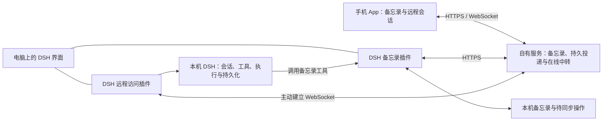

# 技术架构

当前代码已移除桌面、服务端和 Android 的旧备忘录功能；Python 服务保留设备与在线会话中转，Rust 服务保留认证和设备管理，知识工作区保留本地笔记/待办/画布。下文旧备忘录方案仅作历史记录，部署状态见 STATUS.md。

## 2026-11-11：Rust 备忘录服务

- 2026-11-12：本地数据访问改为 Diesel ORM 与 diesel-async；保留原 SQLite 表结构、数据库标识、版本及接口语义。SQLite 专用配置和初始建表使用 SQL，线上是否更新以 STATUS.md 为准。
- `server-rust/` 是独立的 Rust + Axum + SQLite 备忘录服务，提供邀请码注册、设备绑定登录/刷新/撤销与版本化备忘录 API；使用独立数据目录和新数据库。原 `server/` Python 服务保留，Rust 版不读取或迁移其数据。
- 插件界面和 AI 继续共用本地备忘录服务；登录后打开页面主动触发同步，原有后台补查和本机写入触发保留。同步仍使用版本保护、删除标记和本地冲突副本。
- 登录时插件在本机回环地址启动受随机凭据保护的 MCP 服务，并通过 DSH 官方 MCP 客户端注册 `sync_memos`；它调用同一个本地同步服务，返回状态、待同步数和冲突数。退出登录后移除工具并关闭本机服务；无需登录时本地备忘录工具仍可用。
- Rust 版首批不提供设备指令、定时计划、在线会话或服务端 MCP；涉及非空计划/投递的写入会被明确拒绝。旧 Python 服务的相关能力没有删除，也不能由 Rust 版替代。

以下章节记录原 Python 服务及此前方案，不作为 Rust 版的功能承诺。

## 原 Python 后端实现

用户指定 Python、FastAPI 和 uv，服务位于 `server/`，Python 基线为 3.13。使用标准库 sqlite3，不引入 ORM、独立 MQ 或 Redis。数据库操作与密码计算在线程池执行，设备通知在应用事件循环内运行；部署限定单服务进程。

本轮实现账户创建、设备登录/刷新/撤销、带项目名称的备忘录版本化 CRUD/追加，以及 SQLite 持久投递。仅保留账户、设备、备忘录、投递四张表。对外 API/MCP 仅提供基本业务功能，备忘录内包含投递状态；设备 WebSocket 负责直接推送指令和接收回执。新增一个认证 `/api/remote/call` 入口，经原设备 WebSocket 转发固定会话操作；DSH 执行端由 `plugins/devices` 承载。操作协议和运行方法见 [后端说明](server/README.md)，不将方案中其余能力视为已实现。

实现选择：项目仅为备忘录的 `project` 文本字段，空字符串表示未归类；创建时附带的指令复制项目名称和正文，默认新建会话。创建重试返回现有记录的当前状态；修改、追加、删除以版本号保护，旧版本重试返回 409，由客户端核对结果，不能盲目换版本再提交。删除与取消尚未发送的指令在同一事务完成，进入发送未确认时拒绝删除。MCP 按锁定 SDK 的实际支持使用 2025-11-25 协议，不能仅凭查阅更新规范就宣称已兼容。

### 后端 DDD 分层

后端按身份与设备、备忘录、指令投递和在线转发划分职责，仍是一个服务进程。分层用于隔离业务规则、用例与外部技术，不增加数据库表或部署组件。

| 层 / 目录 | 职责 |
| --- | --- |
| `domain/` | `Account`、`Device`、`Memo`、`Dispatch` 及值对象；维护设备启停、备忘录版本与删除、投递租约和回执等规则。仅依赖标准库，不依赖 HTTP、Pydantic、SQLite 或 JWT。 |
| `application/` | 身份、备忘录、投递、在线转发应用服务；接收普通命令对象，编排仓储、事务、认证与提交后通知，通过端口声明所需能力。 |
| `infrastructure/` | SQLite 仓储与工作单元、JWT/密码哈希适配器、进程内通知、有界在线中转。实现应用层端口，不决定业务状态迁移。 |
| `interfaces/` | REST、MCP、WebSocket 入口；Pydantic schemas、命令转换、认证依赖和错误到协议状态的映射。调用同一套应用服务。 |
| `bootstrap.py` / `app.py` / `cli.py` | 组合根负责注入具体实现；ASGI 和 CLI 负责启动、路由与资源生命周期。 |

代码依赖由外向内：接口层、基础设施层依赖应用层与领域层；应用层依赖领域层，不能反向导入 FastAPI 或 SQLite。`bootstrap.py` 统一装配，接口适配器不自行创建数据库、密码组件或业务服务。接口参数放在 `interfaces/schemas.py`；领域实体与数据库表定义分开，四张表仍由 `infrastructure/sqlite/database.py` 定义。

一次写用例通过工作单元（Unit of Work）共享一个 SQLite 连接和 `BEGIN IMMEDIATE` 事务，仓储不单独提交：

- 保存备忘录与创建投递、软删除与取消待发指令均原子完成；异常回滚全部写入。
- 领取指令、确认接收时，设备是否可接单的检查与投递变更在同一事务，避免检查后设备被撤销的竞态。
- 读取用例使用只读事务，备忘录与投递等多仓储读取共享同一个快照。
- 通知在提交成功后触发，不在事务中执行网络交接；通知丢失仍由持久投递记录及补查恢复。

在线会话转发通过应用服务检查身份与设备归属，再调用中转端口；基础设施只管理连接、关联请求、超时与容量限制。等待结果期间不持有数据库事务，返回结果前再次校验访问者凭据。

后端分层仍使用四张表；定时计划将数据库由版本 2 升级到版本 3，旧数据与即时投递协议保留。旧顶层 `service.py`、`auth.py`、`db.py` 等实现已移除，内部 Python 调用方使用应用服务和组合根；不维护两套业务实现。分层依赖、纯领域规则、事务与旧库兼容均有回归测试，部署验证另见 STATUS.md。

## 组成和数据流

`plugins/memos` 和 `plugins/devices` 是独立分发包，共享登录、续期及本地持久记录。上游只提取 carrier/控制路由并保留许可证和对应测试，未引入其账户服务、全局网关切换或终端能力。当前使用 HTTPS/WSS，未实现端到端加密。插件的 Node 后台在 macOS 读取系统 HTTPS 代理及常见例外，HTTP 与 WebSocket 共用代理选择；也支持进程 `HTTPS_PROXY` / `NO_PROXY`。

两套插件分别按业务划分，不按 Host / Client 划分。两者都可包含 Host 后台模块和 Client 界面模块，共用小型协议与连接库；共享库不增加部署服务。

## DSH 备忘录插件

- Client 通过 DSH 正式侧栏/主面板插槽提供备忘录方格、编辑弹窗、阅读预览、同步反馈及冲突对比。界面暂不展示或编辑项目、分类、标签；持久数据及 API 字段保留，正文保存时原样携带已有值。设备指令与定时任务入口保留，不改 DSH DOM。
- 会话输入区加号通过 DSH `commandUi` 注册备忘录选择器，分页读取当前账户已保存的本机记录；选择后重新读取正文，以 DSH 原生引用快照加入当前草稿，发送时由 DSH 序列化。引用可移除，不自动发送，也不会随之后的备忘录修改而变化。此接入已在 DSH 0.2.2-rc.1 隔离环境验证；宿主不提供相关服务时备忘录面板仍可使用。
- Host 提供读取以及受控创建、追加、更新工具，使用与人工编辑相同的数据服务。
- 正文、属性与待同步操作先原子保存到 `DSH_HOME/dogo/local-memos-v1.json`，文件权限 0600；无需 DogO 登录或网络。AI 和界面共用本机服务。该文件没有单独加密，编辑草稿仍保存在 DSH 浏览器存储中。
- 建议首版正文采用纯文本 / Markdown，标题、版本、更新时间等作为结构化字段。是否支持附件待定。
- 登录后以账户和服务地址隔离本机记录，后台分页拉取线上记录及删除标记，并同步本机变更；退出登录后保留最后账户的离线记录。未登录时创建的记录在首次登录时归入该账户。DSH 运行期间每 15 秒补查，也在本机写入和登录时触发。
- 本机 ID、服务器 ID 与各自版本分开；创建携带稳定请求 ID，待同步请求在发送前持久化。结果未知时按原请求核对或重试；两端同时修改时保留本机冲突副本、显示服务器版本，副本不自动上传，需人工核对。AI 与人工编辑服从同样的本机版本保护。
- 备忘录即时指令和定时计划同样先记录在本机，连接后才交给服务；设备接收不代表执行完成。已有计划的普通正文编辑不改写计划。当前 DSH 同步不代表 Android 已支持离线编辑。
- 工具返回应区分“本地已保存”“服务器已确认”“存在冲突”。不因写入成功就宣称其他离线设备已同步。

旧 sync-client 可作为协议和冲突保护的参考，但不将其 Node 文件系统实现作为手机端的前提，也不恢复旧后台自动合并流程。

## DSH 远程访问插件

- Host 主动连接中转服务并报告设备在线状态，不依赖手机直接访问电脑地址。
- 已将列表、最近记录快照、创建、续聊、停止，以及工作区列表、模型目录和模型选择转接至 DSH 正式接口。远端创建可指定已有 `workspaceId`，由 DSH 绑定项目和执行目录；这是远端原生工作区，不新增服务器项目表，也不将备忘录项目文本自动映射为目录。审批/提问仍需回到执行电脑；不承诺完整自定义插件界面。
- B 在原生创建前持久保存稳定 sessionId/requestId 与目录，调用 DSH 幂等创建及 prompt，确认后才记录接收并 ACK；重投返回原会话。未新增 Agent 状态机。
- Client 提供设备选择和远程会话面板，使电脑 A 也能操作电脑 B。只有手机 App 不足以覆盖电脑之间访问的需求。
- 一个设备可以同时是访问方和执行方，具体会话的所属设备始终明确。

在线中转只保留内存等待项：每设备最多 16 个、全局最多 128 个，12 秒超时。未知接收结果必须用原 requestId 重试，不进入离线任务队列。最近 30 条消息的记录按需读取，服务端不保存会话副本。

远程界面不自动获得所有第三方 DSH 插件的界面能力。首轮需核对正文、工具事件、审批和提问的表达；完整自定义插件界面兼容不作为默认承诺。

## 自有服务

采用一个服务进程，按模块划分备忘录、投递和中转职责，SQLite 存于服务所在机器。用户已确认指令需要离线排队；首版以 SQLite 投递表作为持久队列，不预设独立消息队列、Redis 或服务器 Agent。投递和首批文本会话转发已实现；审批/提问及完整 DSH 界面中转仍后置。

| 职责 | 服务端保存或维护什么 |
| --- | --- |
| 个人身份与设备 | 认证、设备登记和撤销、连接状态 |
| 备忘录 | 已同步内容、项目名称、版本、创建请求标识及删除标记 |
| 指令投递 | 指令和内容快照、目标设备、去重标识、投递状态及 B 返回的会话关联 |
| 远程会话中转 | 在线连接和请求路由，转发命令、回执与会话事件 |

完整会话历史与执行状态归原设备 DSH。服务端转发成功不等于 B 已接收；不保存完整会话副本。带指令的备忘录可以等待离线 B 上线，但会话查看和即时续聊不因此变成离线可用。服务仍有存储、连接和流量成本，不称为零负担。

### 内容、操作与项目

用户确认保留四张表；取消独立项目、登录记录和通用请求去重表。准确字段以 `server/src/dogo_server/infrastructure/sqlite/database.py` 为准，职责如下：

- `accounts`：账户身份和密码哈希。与设备分开，表达一个账户拥有多台设备。
- `devices`：设备归属、名称、类型、是否启用，以及当前刷新凭据哈希、到期时间和令牌版本。每设备只保留一份有效登录状态，没有登录历史表。
- `memos`：正文、项目分组名称、分类、标签、创建设备、版本及删除标记。项目暂时没有独立内容，所以直接保存文本；分类和标签也不拆关系表。
- `dispatches`：一次明确的指令、目标设备、派发时正文/项目名称、投递状态和接收后的原生会话 ID。此表同时承担持久队列，默认新建会话。
- 创建备忘录和派发的 `request_id`、输入哈希直接落到各自业务表；账户内唯一约束和事务防止重复入库。重试返回已有记录当前状态，不重放历史响应。更新、追加和删除只按版本判断，不积累逐次操作记录。
- 设备名称是展示字段；由稳定 device_id 路由，必要时留名称快照。account_id 来自已验证身份，不能信任普通请求参数或模型传入值。
- 备忘录可反复修改，一次投递使用生成时的内容及指令快照。修改标签或正文不隐式重复派发；已有备忘录可设置未来定时计划，不提供立即重新派发的独立动作。
- “是否激活”不能同时表示备忘录可见、允许投递和执行成功。待投递取消、已接收之后停止，以及删除备忘录的关联行为需分别定义。
- 备忘录按记录版本同步，不同步服务器 SQLite 文件，也不要求套用文件目录同步层。离线删除需要删除标记，避免其他设备将旧内容重新上传。

用户界面只需一条内容及一个“保存并交给 B”动作；业务层在同一事务中保存备忘录与投递记录。创建和查询均返回同一备忘录结构，其中包含投递状态，不另外开放投递创建/查询/取消接口。没有指令时仅保存内容；不因普通编辑而发起执行。

项目当前只表达分组，例如个人账本或某个想法，不强制等于 Git 仓库、设备本地目录或一个长期会话。暂不提供统一改名或项目说明；以后出现独立项目内容再考虑拆表。如需指定工作目录，由执行端另定本地映射，不把另一台设备的路径直接照搬。

记账等持续业务的连续性应保存在项目下的业务记录中，而非依赖一个永不结束的会话。首版可以继续用备忘录采集原话并保存处理结果；准确统计需要何种结构化账目仍待业务方案明确，不自动增加专用账本系统。每笔记录的采集不必启动 Agent，有明确操作时才派发。周期归集/汇总与定时自动触发分开；后者的当前实现见下文。

### 不独立部署 MQ 的投递方式

1. 通过同一 SQLite 事务保存备忘录和待投递指令；客户端重复提交使用同一幂等键。
2. SQLite 事务提交成功后，业务代码直接调用同进程 `wakeDevice(deviceId)`，通知对应在线设备有待处理记录；不需要 SQLite 主动推送，也不需要独立事件总线或轮询服务。设备连接完成时立即查询它的待投递记录，服务重启后通过设备重连恢复。
3. DSH 插件主动建立认证 WebSocket；服务端直接推送指令和内容快照，设备在同一连接回传接收确认，不另调用 HTTP 领取或确认接口。离线时记录留在 SQLite。
4. 每设备一个连接，一次等待一条接收回执；收到回执后立即推送下一条，不等待 Agent 执行完成。投递带稳定指令 ID，重连立即恢复未确认指令，超时后更换租约凭据重投；设备必须持久去重并复用原生会话映射。
5. B 确认接收需以本地持久记录为依据。投递成功与 DSH 执行成功分开，服务器首版只记录必要接收回执与会话引用，不复制完整执行历史。
6. 设备崩溃造成 DSH 已执行但回执无法确认时，核对实际会话或标记待核对，不盲目自动重跑。删除备忘录只取消未进入发送的指令；已发送未确认时返回冲突，即使租约过期也不假定撤回成功。已确认后删除不停止运行。

WebSocket 是已实现的设备投递通道，SQLite 记录是待办依据；断开网络不丢失记录。首批文本会话调用复用此通道；复杂交互中转后置，不承诺“恰好一次”执行。

### 唤醒与通信方式的取舍

- 推荐“提交后即时唤醒 + 设备上线补查 + 低频定时补漏”。定时器在现有服务进程内运行；例如 30–60 秒仅作为初始候选，实际频率按延迟目标和测量调整。查询按目标设备、投递状态等建索引并限制批次，不周期全表扫描正文。
- 唤醒提示仅在服务进程内部合并，不负责持久保存工作。连接处理器从 SQLite 选出未确认指令，直接通过 WebSocket 发送；设备收到后回执。丢唤醒由补查恢复，重复投递不应重复执行。
- 若只做低频异步指令，设备定时 HTTP 拉取就可成立，代码最直观，代价是等待间隔和空请求。长轮询可缩短等待，但仍需管理挂起连接、超时和重连。
- 当前同时需要实时远程会话，因此推荐每个在线 DSH 执行端复用一条 WebSocket，承载指令提示和按需订阅的会话事件；它是现有服务内的连接，不增加独立部署进程。手机只在使用实时功能时维持连接，不要求为等待 B 完成任务而一直后台联网。
- WebSocket 本身不保证可靠投递，也不意味着没有开销；还需心跳、重连退避和有界发送缓冲。目标服务器上的连接、CPU、内存和流量尚未实测。暂不为少量个人设备引入独立 MQ；多实例、高吞吐或复杂消费者需求出现后再评估。

通信依据：[RFC 6455](https://www.rfc-editor.org/rfc/rfc6455.html) 定义 WebSocket 的单连接双向通信与帧；[RFC 6202](https://www.rfc-editor.org/rfc/rfc6202.html) 说明 HTTP 轮询、长轮询和流式传输的取舍。协议事实不构成本项目的性能测试结果。

### API、MCP 与认证

- 常规 API 与 MCP 是同一应用服务的两种适配入口，共用身份解析、校验、业务规则和数据访问；不复制两套 CRUD 实现。
- MCP 提供备忘录读取、写入和设备列表，指令作为创建备忘录的可选字段；不提供独立派发管理工具。设备控制使用认证 WebSocket 推送与回执，持久队列仍由 SQLite 支撑。
- JWT 可作为访问凭证格式，但不替代登录、续期和撤销。自有客户端与插件可以携 Bearer 凭证调用；若支持通用 MCP 客户端标准登录，还需要相应 OAuth 授权与发现流程。按实际 DSH 支持的 MCP 版本固定兼容范围。
- 登录携带本客户端稳定设备 ID，校验密码后登记设备并签发绑定设备的凭据。同设备重新登录替换旧凭据，退出仅撤销本设备，不影响其他设备；不再另做账户令牌转设备令牌的两步流程。
- 不建设复杂角色权限，但每次访问都检查账户归属及目标设备归属。验证 JWT 的签名、有效期和接收方等必要条件，长期设备凭据需要可撤销；使用成熟认证库。
- 服务器中转连接也必须认证。会话消息和事件经认证路由后转发；不做绕过账户/设备边界的任意网络代理。

参考依据：SQLite 的[适用场景](https://sqlite.org/whentouse.html)与[事务保证](https://sqlite.org/transactional.html)，MCP 的[当前传输规范](https://modelcontextprotocol.io/specification/2026-07-28/basic/transports/streamable-http)与[认证规范](https://modelcontextprotocol.io/specification/2026-07-28/basic/authorization)。查阅日期 2026-10-26；文档能力不等同于目标 DSH 已兼容。

## 2026-11-03：定时投递

用户已确认单次定时、周期触发、离线等上线补执行，以及多个错过周期只补一次。下述功能已在本地实现；安装与部署状态见 STATUS.md。

### 最小组成

- 延续一个 FastAPI 进程、SQLite 和设备 WebSocket，不增加部署服务或独立队列。服务端负责时间判断，手机/插件负责设置，执行电脑上的 DSH 负责接单运行。
- 一条备忘录最多关联一个执行计划、一个目标设备。计划是备忘录的可选值对象，表示以后何时投递；`dispatches` 继续表示每次具体投递。不把历史投递行重置成下一次任务。
- 保留四张表：`memos` 增加可选计划配置（独立计划标识、指令、目标设备、单次/周期规则、时区、启停）及可索引的 `next_run_at`；配置使用受 schema 校验的 JSON，下一触发时间为服务端维护的独立列。`dispatches` 增加计划标识及原定触发时间，用于关联、展示及去重。没有计划的旧备忘录行为不变。
- 原有“立即处理”保持。新增单次指定日期时间；周期支持每天、每周、每月的固定时间，暂不开放自由 Cron。默认 `Asia/Shanghai` 并随计划保存，服务端比较 UTC 时间戳；每月指定日期不存在时使用当月最后一天。周期按原规则计算，不以补执行时刻重新起算。

### 触发与合并补执行

1. 同一进程内约每 30 秒按索引、限批查询到期且启用的计划；启动后立即补查，设备连接时也补查该设备的到期计划。在线通常有一个扫描间隔的触发延迟，不承诺准点完成。
2. 在同一个写事务中，核对账户/设备归属、设备启用、备忘录未删除且启用、计划仍到期，然后生成一条 `pending` 投递并暂时清空 `next_run_at`。投递保存生成时的正文、项目、指令快照及稳定 ID。事务成功后才通知设备。
3. 每个计划最多一条 `pending/leased` 投递，由数据库约束与事务共同保证；设备离线期间这条记录一直保留，不按每个错过周期新增记录。下一触发时间为空时，界面根据投递状态显示等待接收，而非误判已完成。
4. 电脑上线后沿用现有推送、持久去重和回执流程。首次有效回执在同一事务中确认本次投递：单次计划不再安排；周期计划取当前确认时刻之后、符合原规则的第一个时间点，写回 `next_run_at`。重复回执不得重复推进，新计划不得被旧回执修改。
5. 服务重启从 SQLite 恢复。生成前崩溃仍有到期时间；生成后崩溃已有投递记录；接单后回执丢失沿用原投递 ID 重试。数据库使用“计划标识 + 原定触发时间”唯一约束防重复生成，设备继续复用原生会话/请求 ID，不宣称外部副作用恰好一次。

例：每天 09:00，电脑连续三天离线，第四天 11:00 上线，只交给 DSH 一次；确认接收后下一次为第五天 09:00。如果第四天 08:00 已补跑并确认，第四天 09:00 仍是下一次正常周期。

### 修改、暂停和执行边界

- 每次有效投递默认新建会话。编辑正文影响以后尚未生成的投递，已生成投递保留快照；界面应显示这一边界。
- 修改计划时沿用备忘录版本校验：该计划未发送的旧投递取消，生成新计划标识并按新规则排期；已发送待确认时拒绝改写本次计划，待确认后再改。原本独立的即时投递不受计划修改影响，确认过的历史记录保留。
- 暂停停止后续调度并取消尚未发送的投递；已发送或已接收的本次不撤回，回执仍可处理。恢复须先解决旧发送中的投递，重新排期使用新计划标识，避免复用已取消时点的去重键。恢复周期计划从恢复后的下一个正常时间点开始，不补暂停期间；单次计划原时间已过且尚未接收则恢复后补一次，已接收的单次计划不重复执行。删除沿用现有发送中拒绝删除规则，并停止未来调度。
- “启用设备”仍不等于在线；明确禁用设备时不继续投递，恢复启用后才允许按离线合并规则处理。备忘录停用时暂停其调度，恢复时按计划恢复规则处理。
- 回执仍只表示 DSH 已接单，不表示 Agent 执行成功。首版不增加执行完成回传、失败自动重跑或跨周期运行互斥；前一次已经接收但仍在运行时，后续正常周期可能创建新会话。界面不使用“已执行成功”描述接收状态。

### 接口、DDD 与验证

- REST/MCP 继续通过备忘录读写接口设置/修改可选计划，共享认证和应用服务；不重新开放独立投递管理接口。返回计划配置、下次触发时间及最近一次投递摘要，不加入完整任务历史管理页面。手机和 DSH 备忘录插件增加同样的执行时间设置；设备插件复用现有接单链路。
- 新增参数区分“未提供计划字段”和“显式取消计划”：旧客户端普通保存不得清空新计划。保留旧创建请求哈希及重试兼容，当前即时投递请求格式继续有效。计划配置变更遵循用户版本校验；服务端调度游标推进不改正文版本，也不接受客户端覆盖游标。
- 领域层的计划值对象负责规则和下一时间计算；应用层调度用例负责生成投递、合并和回执推进；基础设施只负责定时唤醒、SQLite 和网络。后台循环不直接承载业务规则，也不在数据库事务中等待网络。
- 数据库通过事务将 v2 迁移为 v3，保留现有账户、凭据、备忘录、请求标识及投递记录。发布顺序为兼容后端，再更新手机和插件；部署前备份现有数据。
- 已验证范围和局限见 STATUS.md；重点包括离线合并、重启、重复扫描/回执、月末/时区、旧客户端及界面操作。

## 手机 App

用户已确认手机端不运行 Agent，先做现有 HTTP API 的简单客户端，不接模型供应商、MCP 或桌面设备投递 WebSocket。旧 App 中的 Agent、工具审批、记忆分析和后台执行模块不恢复。

- 登录/设置：服务地址、账号密码及设备名称；设备以 `mobile` 类型登录，保存稳定设备 ID，自动刷新凭据，支持退出。凭据按服务与账户隔离，不保存明文密码。
- 备忘录列表：分页、按项目筛选、主动刷新；回到前台读取服务端最新状态，不把本地旧列表当成已同步结果。
- 备忘录详情/编辑：正文、项目、分类、标签与启用状态；创建、修改、追加、删除。已有内容按完整字段更新，不能因表单未显示某字段而清空它。
- 创建时可选附带指令与目标桌面设备；详情中展示等待发送、等待接收确认、已接收或已取消。已接收不显示为执行完成。没有单独任务管理界面。
- 设备管理放在设置内：查看已登记设备、禁用设备；`active` 只表示启用状态，现有接口没有在线状态，不将其显示为“在线”。

首批实现以在线读写和本地草稿保护为边界，完整离线编辑同步后置。创建超时保留原请求 ID，重试不得重新创建；修改/追加遇到版本冲突保留本地输入，重新读取核对，不能自动换版本覆盖。删除的发送中冲突显示原因，不伪报成功。完整参数以服务端 `/docs` 为准。

用户已确认 Android，工程位于 `mobile/android`，采用 Java + 原生 Views + HTTP，不增加应用运行时第三方依赖。Keystore 加密保存凭据和每账户一份编辑草稿；应用级队列串行刷新令牌，跨界面重建共享存储。先持久化完整提交，再发出请求；未知结果保持原正文和请求标识/版本，冲突由人工比较处理。本地草稿不是多设备同步库。构建及测试见 [手机端说明](mobile/README.md)。

Android 远程会话界面仍后置；后端已新增独立在线调用入口，不使用备忘录投递冒充会话聊天。

## 交互会话的接收与断线边界

1. 手机生成稳定 requestId，经服务器发往在线 B。
2. B 记录请求，并通过 DSH 接口处理；以 B 返回的确认作为交付边界。
3. 手机收到确认后可断开，B 继续运行。需要审批时等待用户，B 必须保持运行。
4. 确认丢失时保留“接收状态待确认”，重连按原 requestId 查询，不自动创建一条新命令。
5. B 在交接过程中退出导致执行结果未知时，读取 DSH 实际状态或明确提示核对，不凭缺失回执自动重跑。

提交消息与订阅输出分离，关闭观看连接不自动转换为取消执行；停止必须作为明确命令传给 B。异步备忘录指令另按上述持久投递流程执行，不能把“服务器已入队”显示成“B 已接收”。

备忘录追加和远程消息发送都必须防止重试产生重复副作用，但不宣称能对所有故障提供“恰好一次”执行。

## 维护边界

- 使用官方 DSH 和正式插件扩展点，不 fork 上游、不维护自有桌面外壳，不修改上游页面 DOM。
- 先用最小探针核对目标 DSH 版本的会话、事件和插件 UI 接口，再固定一起验收的版本组合；不自动升级现有安装。
- 连接、认证、重连和能力探测作为共享模块；备忘录与远程访问保持各自数据边界。
- 后续功能以新的明确场景加入；长期个人助理方向不构成本轮实现依据。
- 数据库当前为版本 3，启动时事务升级版本 2；版本 1 仍明确拒绝启动，不自动迁移或删除已有数据。开发验证使用独立数据目录。
