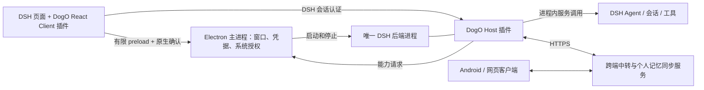

# 架构与边界

当前源码采用 **DSH 后端 + DogO Host/Client 插件 + 原生客户端能力**。桌面不再启动独立的 `apps/runtime`；DSH 版本锁定 `0.2.0-rc.2`，不 fork 上游。产品基线见 [产品文档](docs/product-v0.1.0.md)，此次实施与验证范围见 [STATUS](STATUS.md)。历史安装版的验证不能替代本轮源码的实机验收。

## 进程和调用关系

Electron 的渲染进程、DSH 的工具子进程仍然存在。“唯一后端”指唯一桌面 Agent 执行宿主，不是整个应用只有一个操作系统进程。

Electron 直接管理 DSH 子进程；插件挂载业务服务后返回版本、PID、启动代次握手。外壳通过每次启动的私有 Bearer 回环接口连接插件，不再使用 JSON-lines runtime RPC。插件内部直接调用 DSH 服务，不再经过 HTTP 启动第二套 DSH。关闭窗口继续后台运行；完整退出停止接单、保存回执、停止原生能力与 DSH。父进程 stdin 断开触发 DSH 退出；客户端心跳过期也会撤销中转连接。

## 目录与数据归属

| 目录 | 职责 |
| --- | --- |
| `apps/desktop/src/host` | DSH 启动、profile、版本握手、健康检查、退出；不拥有 Agent 循环 |
| `apps/desktop/src/native` | 本机权限文件、电脑操作、Codex CLI、SSH、子进程取消 |
| `apps/desktop/src/main.mjs` | 窗口/托盘、系统凭据、文件选择、IPC 校验与原生确认 |
| `apps/web` | Electron 标题栏、启动/连接失败恢复；业务页面已移入插件 |
| `packages/dsh-plugin/src/host` | 中转、项目与设备索引、资料、个人记忆、兼容历史和业务 SQLite |
| `packages/dsh-plugin/src/client` | DSH 插件导航及 React 任务/资料/设置/记忆界面 |
| `packages/dsh-plugin/src/sessions.mjs` | 原生会话映射、远程命令去重、审批、历史与执行回执 |
| `packages/hub-ui` | 桌面插件、Android、网页共用的 React 业务组件与离线队列 |
| `packages/contracts` | 插件握手、RPC 输入、本机权限及配对协议校验 |
| `packages/sync-client` | 不依赖服务器进程的文件同步/HTTP 客户端；构建为 Node 可加载的 JS |
| `apps/mobile` | React + Capacitor Android，以及已实现的独立手机轻量 Agent |
| `apps/others/services` | 可单独部署的账号、中转、资料与文件同步服务 |

`DSH → DogO Host 插件 → contracts / sync-client`；`Client 插件 → hub-ui`。生产插件不依赖服务器应用包。桌面进程管理器不再包含业务 Engine。兼容回归夹具仅在插件测试目录中组装旧调用方式。

DSH 自己管理模型、插件、Agent 循环、原生会话及其持久化。DogO 管理跨端 requestId/executionId/nativeId 映射、资料与同步回执，不能另建一套同义 Agent 状态机。个人记忆以专用文件夹为载体，项目记忆不自动参与同步。

## 插件范围和权限

Host 插件可以承载后台业务、定时同步、工具、HTTP API、系统提示词扩展和持久化服务；Client 插件通过上游槽位注册导航与 React 面板。`ctx.effect()` disposer 负责移除路由/界面、关闭服务、checkpoint 和释放锁。没有复制上游 UI 或依赖 DOM 选择器。

插件按可信代码对待，不是安全沙箱。浏览器 `/dogo-client` 使用 DSH 自身会话认证、Origin 校验和 JSON POST，开放有限业务方法；拒绝连接凭据、本机开关、项目授权和远程自动执行策略修改。带 scope 的缓存/Hub 请求在身份变化后拒绝执行。桌面管理接口仍要求私有 Bearer，并拒绝带 Origin 的浏览器请求。

DSH 隔离视图关闭 Node，开启 sandbox/contextIsolation，持久分区只允许精确回环 origin。新增有限 `dogoNative` preload 提供账号、原生文件选择、权限确认、导出、准备检查和登录项，不传入通用 RPC、令牌或任意系统命令。主进程再次检查当前 view、主 frame 和 origin；权限变更弹出原生确认。

本机权限保存于 Electron 管理的 `native-authorizations.json`。模型不能通过 DogO HTTP API修改这些权限。电脑操作依赖平台实现与系统授权；Codex 保持 workspace-write、授权项目和现有登录；SSH 只接受授权别名、复用本机密钥并严格验证主机密钥。DogO 能力开关不替代 DSH 自身工具权限。

## 数据兼容与模型配置

继续使用 `userData/local/desktop.sqlite`、`personal-memory`、`dsh` profile 和原会话。首次插件接管 SQLite 前执行一致性备份，写入格式版本标记，并持有目录级独占锁；发现活动 owner 或未知版本时拒绝启动。首次从旧配置导入原生权限；保留原文件和设备/会话标识，不转换 Pi 历史。

旧本地模型仅首次导入 DSH profile，同时备份 patch 文件；已有 DSH provider/default model 设置优先。之后模型配置由 DSH 原生设置管理，启动覆盖文件不反复覆盖用户设置。新建 profile 的默认工作区位于本应用数据目录；保留已有 profile 的工作区设置。普通会话、远程原生会话和维护会话使用 DSH 模型选择。准备检查不会把“DSH 已启动”误报为“模型已可推理”。

升级前必须完整退出旧安装版。旧版 runtime 不识别新独占锁，不能同时指向同一个数据目录。回退应先停止新应用，再使用完整备份和旧版本；不能只还原某个 SQLite 文件后继续使用新回执自动执行。

## 多端与可靠性

手机/网页 → HTTPS 中转 → DogO Host 插件 → 原设备 DSH 原生会话。服务保存已同步索引、资料和回执；执行真相仍属于原设备。接收不明先查执行记录，跨重启不会自动重放；非确定结果明确报错，不宣称网络“恰好一次”。资料不自动进入 Agent。

文件同步采用版本 CAS、base/local/remote 冲突和独立维护会话单次尝试。不确定或中断转人工；不直接复制运行中的 SQLite。账号切换、退出或撤销停止接单，原数据保留；系统凭据不交给 React。HTTPS 和本地安全存储不等于端到端加密。

Android 保留当前 AI SDK Agent、原生 HTTPS/Keystore 和逐次工具审批；本轮未将 DSH 移植到手机。Mac/Windows 共用 React 插件和 Node 后端代码；屏幕输入、登录项、凭据存储和打包仍是平台适配，Windows 不能据此算已交付。

详细迁移决策见 [改版方案](docs/dsh-plugin-architecture-plan.md)。所有 DSH 升级仍需重新验证接口、生命周期、认证、原会话恢复和 Client 插件加载。
